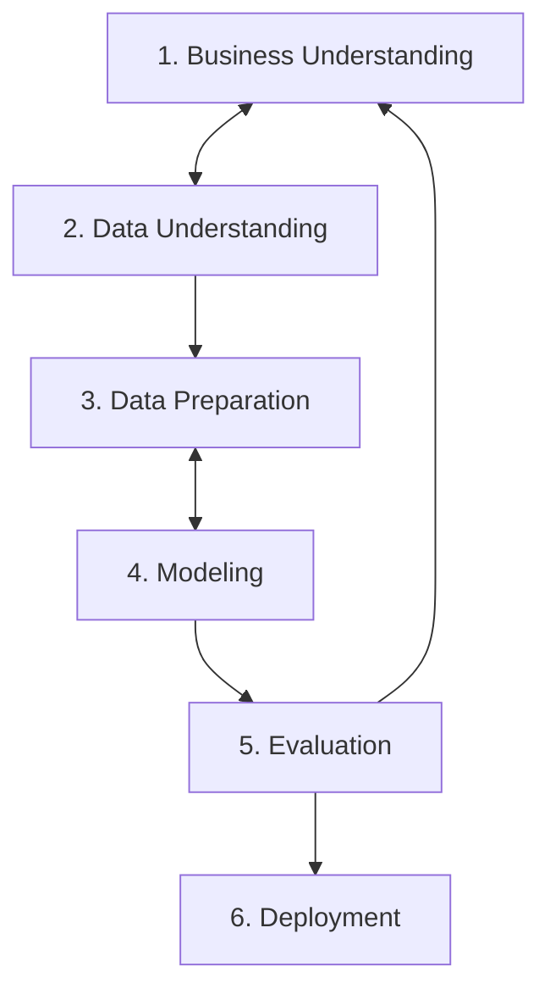

# 📊 CRISP-DM in TypeScript

Una rappresentazione completa e fortemente tipizzata del modello **CRISP-DM** (*CRoss-Industry Standard Process for Data Mining*) scritta in **TypeScript**, basata sul materiale del corso di **Data Mining 1** (*Università di Pisa* — Prof. Dino Pedreschi, Prof. Riccardo Guidotti).

---

## 🎯 Perché uno standard di processo?

Il processo di Data Mining deve essere **affidabile e ripetibile** anche da persone con poca esperienza specifica nel settore. Adottare uno standard come CRISP-DM offre vantaggi concreti:

* **Replicabilità e documentazione**: fornisce un framework uniforme per registrare l'esperienza e replicare i progetti.
* **Supporto alla gestione**: aiuta nella pianificazione e nel management del progetto.
* **Riduzione del rischio**: offre un *"comfort factor"* per i nuovi utilizzatori, dimostra la maturità del Data Mining e riduce la dipendenza da singoli esperti (*"stars"*).

### Caratteristiche principali di CRISP-DM

* **Non proprietario**, neutrale rispetto ad applicazioni, settori industriali (*industry-neutral*) e strumenti (*tool-neutral*).
* **Focus bilanciato**: integra gli obiettivi di business con l'analisi tecnica.
* **Flessibile**: adattabile a diversi problemi aziendali e tipologie di dati, offrendo linee guida, base di esperienza e template di analisi.

---

## 🔄 Il Ciclo di Vita CRISP-DM

Il processo è intrinsecamente **iterativo** e ruota attorno ai **Dati**. La sequenza delle fasi non è rigida: spesso i risultati di una fase richiedono di tornare indietro (es. da *Modeling* a *Data Preparation*, o da *Evaluation* a *Business Understanding*).



---

## 🧩 Le 6 Fasi e i relativi Task

### 1. Business Understanding
Comprendere a fondo gli obiettivi e i requisiti del progetto dal punto di vista del business e tradurli in un problema tecnico di Data Mining. Trascurare questa fase porta al rischio di *"produrre le risposte giuste alle domande sbagliate"*.

* **Determine Business Objectives**: capire cosa vuole realmente ottenere il cliente e individuare i fattori chiave di successo.
* **Assess Situation**: analizzare in dettaglio risorse, vincoli, assunzioni e rischi.
* **Determine Data Mining Goals**: tradurre gli obiettivi di business in obiettivi tecnici (es. da *"Aumentare le vendite da catalogo"* a *"Predire quanti prodotti acquisterà un cliente dati gli acquisti degli ultimi 3 anni, i dati demografici e il prezzo"*).
* **Produce Project Plan**: definire il piano operativo, i passi previsti e una selezione iniziale di strumenti e tecniche.

### 2. Data Understanding
Inizia con la raccolta iniziale dei dati per familiarizzare con essi, individuare problemi di qualità, scoprire i primi insight e formulare ipotesi su informazioni nascoste.

* **Collect Initial Data**: acquisire e caricare i dati elencati nelle risorse del progetto (con eventuale integrazione preliminare se provengono da più fonti).
* **Describe Data**: esaminare le proprietà di superficie (*gross/surface properties*) dei dati acquisiti.
* **Explore Data**: usare query, visualizzazioni e report per analizzare distribuzioni di attributi chiave, relazioni tra coppie di attributi e sotto-popolazioni significative.
* **Verify Data Quality**: verificare completezza, presenza di valori mancanti (*missing values*) e outlier.

### 3. Data Preparation
Copre tutte le attività necessarie per costruire il dataset finale a partire dai dati grezzi. **Richiede solitamente oltre il 90% del tempo totale del progetto** e i suoi task vengono eseguiti più volte senza un ordine rigidamente prefissato.

* **Select Data**: selezionare record e attributi in base a rilevanza, qualità e vincoli tecnici (volume, tipi di dato).
* **Clean Data**: elevare la qualità dei dati (selezione di sottoinsiemi puliti, valori di default, stima dei dati mancanti tramite modelli).
* **Construct Data**: creare attributi derivati, nuovi record o trasformare valori esistenti.
* **Integrate Data**: combinare informazioni provenienti da più tabelle o record.
* **Format Data**: applicare modifiche sintattiche richieste dagli strumenti di modellazione senza alterare il significato dei dati.

### 4. Modeling
Selezione e applicazione delle tecniche di modellazione con calibrazione dei parametri verso valori ottimali. Poiché alcuni algoritmi richiedono formati specifici, è spesso necessario tornare alla fase di *Data Preparation*.

* **Select Modeling Technique**: scegliere gli algoritmi da applicare (es. *Decision Tree*, *Neural Network*) separatamente per ciascuna tecnica.
* **Generate Test Design**: definire la procedura di validazione prima di costruire il modello (es. split in *train set* e *test set* per stimare l'error rate nella classificazione).
* **Build Model**: eseguire lo strumento di modellazione sul dataset preparato impostando i parametri.
* **Assess Model**: valutare e classificare i modelli dal punto di vista **tecnico** secondo la conoscenza di dominio e i criteri di successo del Data Mining (a differenza della fase di *Evaluation*, qui si considerano solo i modelli).

### 5. Evaluation
Valutare approfonditamente il modello e rivedere i passi eseguiti per assicurarsi che gli obiettivi di business siano stati raggiunti e che nessun aspetto critico sia stato trascurato.

* **Evaluate Results**: verificare quanto il modello soddisfa gli obiettivi di business, individuare eventuali carenze e valutare anche tutti gli altri risultati prodotti dal progetto.
* **Review Process**: revisione di *quality assurance* dell'intero processo (*"Abbiamo costruito correttamente il modello?"*).
* **Determine Next Steps**: decidere se passare al *Deployment*, avviare nuove iterazioni o iniziare nuovi progetti, tenendo conto di budget e risorse residue.

### 6. Deployment
Organizzare e presentare la conoscenza estratta affinché il cliente possa utilizzarla. A seconda dei requisiti, può variare dalla semplice generazione di un report all'implementazione di un processo di Data Mining ripetibile a livello aziendale.

* **Plan Deployment**: definire chi utilizzerà i risultati, con quale frequenza e documentare la strategia di rilascio.
* **Plan Monitoring and Maintenance**: essenziale se i risultati entrano nell'operatività quotidiana, per evitare lunghi periodi di utilizzo errato dei modelli.
* **Produce Final Report**: redigere il report finale (sintesi del progetto o presentazione completa dei risultati).
* **Review Project**: analizzare cosa ha funzionato, cosa è andato storto e cosa migliorare nei progetti futuri.

---

## 💻 Utilizzo del modulo TypeScript

Copia il file `crisp-dm.ts` nel tuo progetto e importa le costanti o le interfacce tipizzate:

```typescript
import { CRISP_DM_PHASES, getCrispPhase, CrispPhase } from './crisp-dm';

// Stampare tutte le fasi in ordine
CRISP_DM_PHASES.forEach((phase: CrispPhase) => {
  console.log(`${phase.order}. ${phase.name} (${phase.italianName})`);
  console.log(`   Obiettivo: ${phase.objective}\n`);
});

// Recuperare i dettagli di una fase specifica
const prepPhase = getCrispPhase('data_preparation');
if (prepPhase) {
  console.log(`Task di ${prepPhase.name}:`);
  prepPhase.tasks.forEach((task) => console.log(`- ${task.name}`));
}
```

---

## 📚 Riferimenti

* **Corso**: *Data Mining 1* — Dipartimento di Informatica, Università di Pisa (Prof. Dino Pedreschi, Prof. Riccardo Guidotti).
* **Guida ufficiale**: Pete Chapman (NCR), Julian Clinton (SPSS), Randy Kerber (NCR), Thomas Khabaza (SPSS), Thomas Reinartz (DaimlerChrysler), Colin Shearer (SPSS), Rüdiger Wirth (DaimlerChrysler) — *"CRISP-DM 1.0 - Step-by-step data mining guide"*.
* **Risorse online**: [crisp-dm.org](http://www.crisp-dm.org/) · [KDnuggets](http://www.kdnuggets.com/)